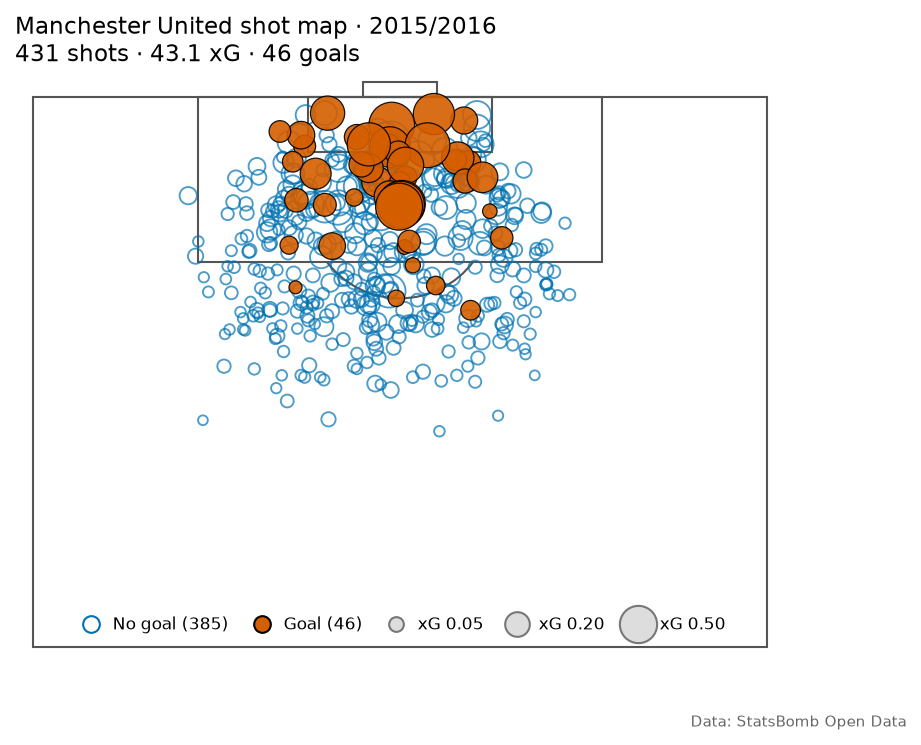
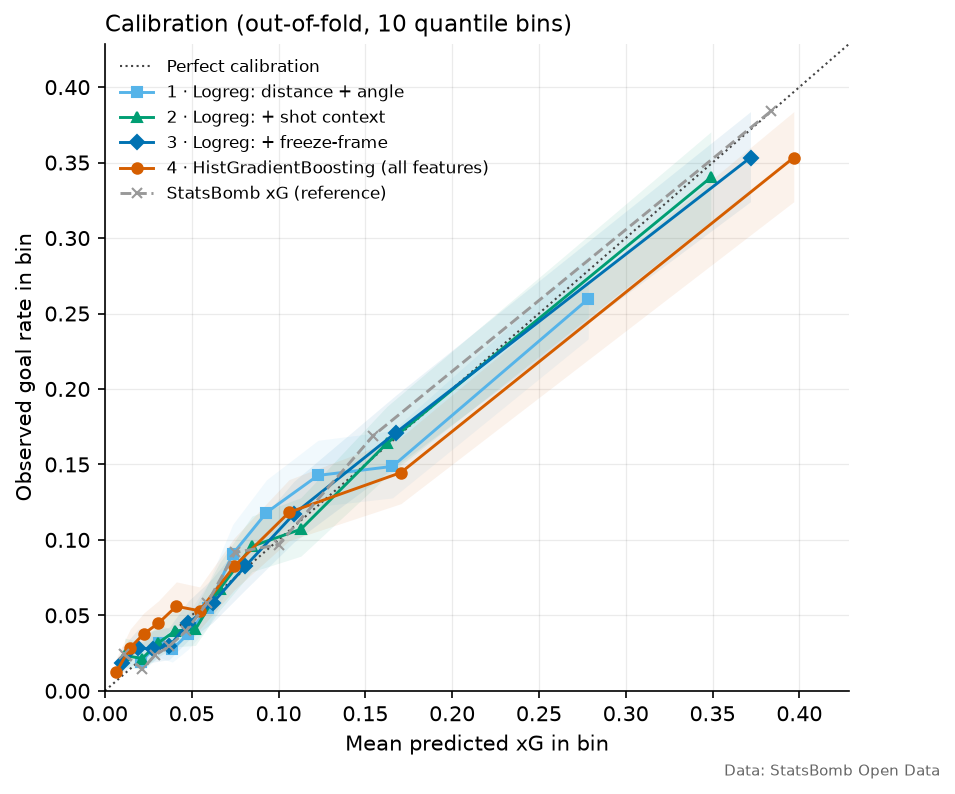
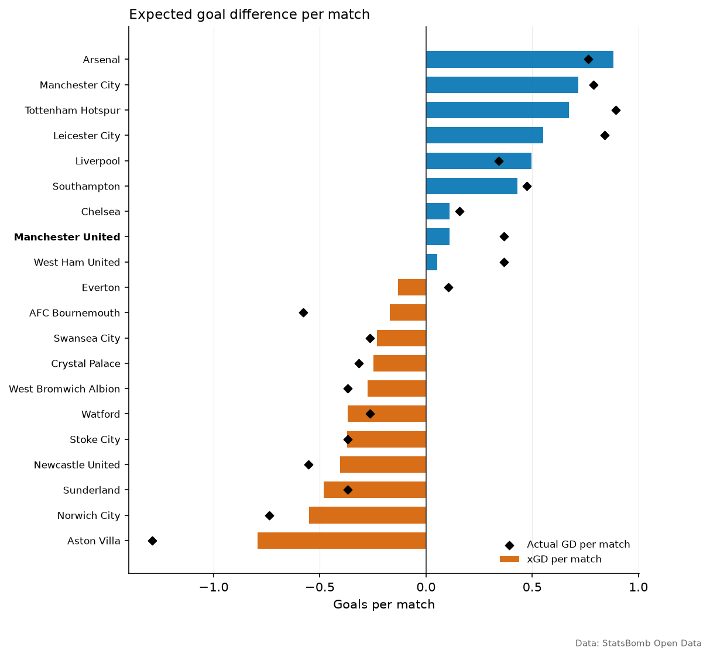
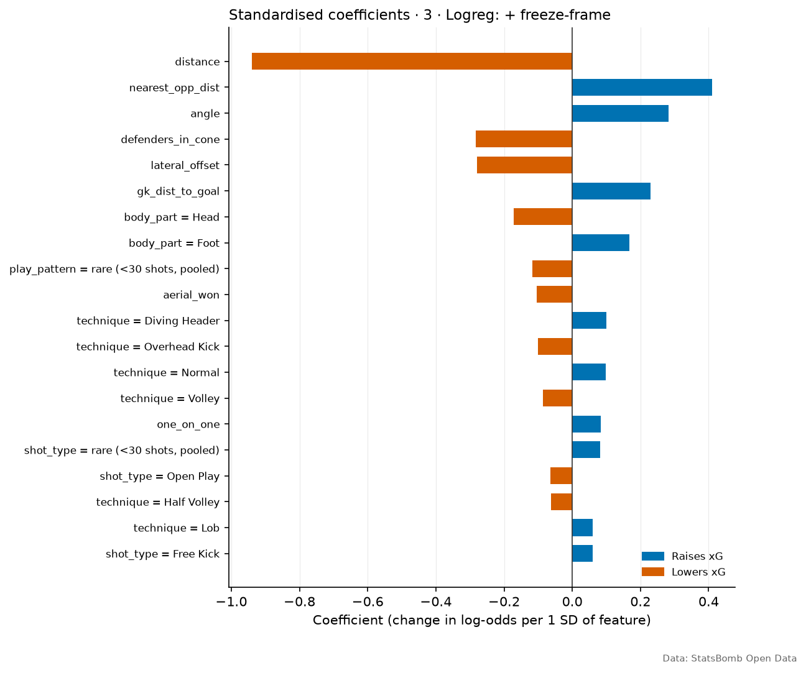
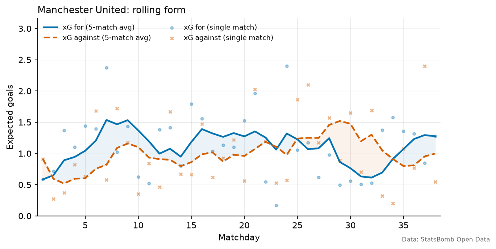

# xG Lab — an honest expected-goals model from raw event data

**xG Lab** builds an expected-goals (xG) model from raw [StatsBomb Open Data](https://github.com/statsbomb/open-data) events, checks it out-of-sample, and uses it to answer three questions a club analyst gets every week:

1. **How good was each team's underlying performance?** (xG, xGA, xGD, expected points)
2. **Who finished better than their chances suggest, and is that real or just noise?**
3. **How did the focus team's form develop through the season?**

Everything comes from one command, from download to figures to a static dashboard. Every number below was produced by that command; none were typed by hand.

> **Season choice.** The brief targeted the Premier League 2025/26. StatsBomb Open Data does not include that season. It publishes only two Premier League seasons, **2003/04** and **2015/16** (checked November 2026). The default is therefore **Premier League 2015/16**, the only complete 380-match PL season available, with **Manchester United** as the focus team. Any other season can be chosen with `--season`, and an unavailable one fails with a list of the seasons that exist.

---

## Quick start

```bash
python -m venv .venv
.venv/Scripts/activate          # Windows  (macOS/Linux: source .venv/bin/activate)
pip install -r requirements.txt
python run_pipeline.py          # ~4 min first run (downloads ~1.1 GB, cached as ~100 MB gzip); ~45 s after
```

| Option | Example | Meaning |
|---|---|---|
| `--competition` | `"La Liga"` or `11` | name or StatsBomb id |
| `--season` | `2015/2016`, `2015/16`, `27` | name or id |
| `--team` | `"Arsenal"` | focus team for shot map and form |
| `--max-matches` | `100` | first N matches chronologically (quick runs) |
| `--offline` | | use only the disk cache |
| `--list` | | print every competition/season StatsBomb publishes |

Outputs:

```
outputs/figures/   shot map, calibration, coefficients, team xGD, rolling form (PNG)
outputs/tables/    every table as CSV (shots, models, calibration, teams, players, ...)
outputs/results.md the tables in this README, generated automatically
dashboard/data.js  data for the static dashboard
```

**Dashboard:** open `dashboard/index.html` in a browser. To serve it locally: `python -m http.server -d dashboard`. Deploy to Vercel with **Root Directory = `dashboard`** (no build step), or from the terminal: `cd dashboard && npx vercel --prod`.

**Tests:** `pytest`. They run fully offline on a synthetic league (see [Testing](#testing)).

---

## Method

### Data
* Events are downloaded from `raw.githubusercontent.com` with retries (exponential backoff on network errors, 429 and 5xx) and cached gzip-compressed on disk. Writes are atomic, so a crash never leaves a broken cache file.
* **Penalty shoot-out kicks (period 5) are removed.** None occur in a league season, but the rule matters for cup competitions.
* **Penalties are not modelled.** Every penalty gets xG equal to the observed conversion rate in the sample (74/91 = 0.813 in PL 2015/16).

### Features: only what is known when the ball is struck

| Block | Features |
|---|---|
| Geometry | distance to goal centre, goal-mouth angle (angle between the posts as seen from the ball), lateral offset \|y − 40\| |
| Shot context | body part (foot / head / other), shot type, technique, play pattern; flags `under_pressure`, `first_time`, `one_on_one`, `aerial_won`, `follows_dribble`, `open_goal` |
| Freeze frame | keeper distance from goal, keeper inside the shooter→posts triangle, number of defenders in that triangle, distance to the nearest opponent, freeze-frame-available flag |

* **No leakage.** `end_location`, `deflected`, `outcome`, `saved_to_post` and StatsBomb's own xG are never model inputs. A unit test asserts this for every model.
* **No redundant transforms.** There is no "distance + log distance" style duplication. Pairwise correlations are written to `outputs/tables/feature_correlation.csv`, and the pipeline logs any pair with |r| ≥ 0.8. None reached that threshold; the strongest was distance vs angle at r = −0.76. Both are kept because they carry different information: two shots at the same distance can have very different angles.
* Left and right foot are merged, because without the player's preferred foot the distinction is noise.
* Categories with fewer than 30 shots are pooled. Missing freeze-frame values are median-imputed **inside each training fold**.

### Models (ablation)
1. Logistic regression: distance + angle
2. \+ shot context
3. \+ freeze-frame features
4. HistGradientBoosting on the same inputs as (3)

**StatsBomb's xG is shown only as a reference.** It is trained on far more data and richer inputs, so it shows how much headroom remains. It is not a target to beat.

### Validation
* **5-fold GroupKFold grouped by match.** Shots from one match never appear in both training and test. All metrics use **out-of-fold** predictions, and every model uses the same folds, so the comparisons are paired.
* Hyper-parameters were **fixed before evaluation, not tuned** on these folds, so the CV estimate is not optimistically biased.
* Metrics: AUC, Brier score, log loss, Σ xG vs goals, and calibration slope/intercept (logistic recalibration of y on logit(p); slope 1 is ideal, below 1 means over-confident).
* Calibration curve on 10 **quantile** bins (equal shots per bin) with 95% Wilson intervals.
* **Is an improvement real?** A match-level (cluster) bootstrap of the log-loss difference, with whole matches resampled 1,000 times.
* The **main model** is the one with the lowest out-of-fold log loss.

### Analysis
* **Team table:** xG, xGA and xGD per match. **Expected points** treat each match as two independent Poisson goal counts with means equal to each side's xG (the score grid is truncated at 10 goals, with the tail mass folded in).
* **Player finishing (non-penalty):** goals vs npxG, and z = (G − npxG) / √Σ p(1 − p), which treats each shot as an independent Bernoulli trial at the model's probability.
* **Team form:** match-by-match xG and xGA with a trailing 5-match rolling mean.

---

## Results: Premier League 2015/16

<!-- The tables below are copied verbatim from outputs/results.md (generated by run_pipeline.py). -->
<!-- generated by run_pipeline.py on 2026-11-10 16:29 UTC -->
**Data:** Premier League 2015/2016 · 380 matches · 9908 shots (9817 non-penalty, 91 penalties, 0 shoot-out kicks dropped) · freeze-frame coverage 100.0%

### Model comparison (non-penalty shots, out-of-fold, 5-fold GroupKFold by match)
| Model | AUC | Brier | Log loss | Σ xG | Goals | Cal. slope |
|---|---:|---:|---:|---:|---:|---:|
| 1 · Logreg: distance + angle | 0.732 | 0.0782 | 0.2789 | 914.5 | 914 | 0.99 |
| 2 · Logreg: + shot context | 0.767 | 0.0740 | 0.2649 | 914.0 | 914 | 0.94 |
| 3 · Logreg: + freeze-frame | 0.781 | 0.0727 | 0.2594 | 916.1 | 914 | 0.94 |
| 4 · HistGradientBoosting (all features) | 0.765 | 0.0742 | 0.2663 | 901.0 | 914 | 0.80 |
| StatsBomb xG (reference) | 0.795 | 0.0705 | 0.2529 | 900.1 | 914 | 0.98 |

Main model (lowest log loss): **3 · Logreg: + freeze-frame**. Penalty xG = observed conversion = 74/91 = 0.813.

### Log-loss difference vs. baseline (match-level bootstrap, 95% CI; negative = better)
| Comparison | Δ log loss | CI low | CI high | P(better) |
|---|---:|---:|---:|---:|
| 2 · Logreg: + shot context vs model 1 | -0.0140 | -0.0181 | -0.0104 | 1.000 |
| 3 · Logreg: + freeze-frame vs model 1 | -0.0195 | -0.0241 | -0.0153 | 1.000 |
| 4 · HistGradientBoosting (all features) vs model 1 | -0.0126 | -0.0185 | -0.0071 | 1.000 |
| 3 · Logreg: + freeze-frame vs StatsBomb xG | +0.0065 | +0.0026 | +0.0099 | 0.000 |

### Team table (sorted by xGD per match)
| Team | MP | xG/match | xGA/match | xGD/match | Pts | xPts | Pts − xPts |
|---|---:|---:|---:|---:|---:|---:|---:|
| Arsenal | 38 | 1.82 | 0.94 | +0.88 | 71 | 72.6 | -1.6 |
| Manchester City | 38 | 1.75 | 1.03 | +0.72 | 66 | 67.1 | -1.1 |
| Tottenham Hotspur | 38 | 1.64 | 0.96 | +0.67 | 70 | 68.2 | +1.8 |
| Leicester City | 38 | 1.80 | 1.24 | +0.55 | 81 | 64.8 | +16.2 |
| Liverpool | 38 | 1.51 | 1.02 | +0.50 | 60 | 63.2 | -3.2 |
| Southampton | 38 | 1.46 | 1.03 | +0.43 | 63 | 62.5 | +0.5 |
| Chelsea | 38 | 1.46 | 1.35 | +0.11 | 50 | 55.4 | -5.4 |
| Manchester United | 38 | 1.13 | 1.02 | +0.11 | 66 | 54.7 | +11.3 |
| West Ham United | 38 | 1.44 | 1.39 | +0.05 | 62 | 52.3 | +9.7 |
| Everton | 38 | 1.40 | 1.53 | -0.13 | 47 | 50.7 | -3.7 |
| AFC Bournemouth | 38 | 1.09 | 1.26 | -0.17 | 42 | 49.3 | -7.3 |
| Swansea City | 38 | 1.13 | 1.36 | -0.23 | 47 | 46.5 | +0.5 |
| Crystal Palace | 38 | 1.14 | 1.39 | -0.25 | 42 | 46.4 | -4.4 |
| West Bromwich Albion | 38 | 1.04 | 1.31 | -0.27 | 43 | 44.6 | -1.6 |
| Watford | 38 | 1.16 | 1.53 | -0.37 | 45 | 45.2 | -0.2 |
| Stoke City | 38 | 1.06 | 1.44 | -0.37 | 51 | 44.9 | +6.1 |
| Newcastle United | 38 | 1.07 | 1.48 | -0.41 | 37 | 43.4 | -6.4 |
| Sunderland | 38 | 1.12 | 1.60 | -0.48 | 39 | 41.6 | -2.6 |
| Norwich City | 38 | 1.05 | 1.60 | -0.55 | 34 | 41.0 | -7.0 |
| Aston Villa | 38 | 0.79 | 1.58 | -0.79 | 17 | 32.9 | -15.9 |

### Finishing: top and bottom 10 by goals − npxG (≥ 20 non-penalty shots)
| Player | Team | Shots | NP goals | npxG | G − npxG | z |
|---|---|---:|---:|---:|---:|---:|
| Sergio Leonel Agüero del Castillo | Manchester City | 113 | 20 | 14.5 | +5.5 | +1.65 |
| Riyad Mahrez | Leicester City | 81 | 13 | 7.5 | +5.5 | +2.17 |
| André Ayew Pelé | Swansea City | 69 | 12 | 7.6 | +4.4 | +1.78 |
| Anthony Martial | Manchester United | 57 | 11 | 6.8 | +4.2 | +1.85 |
| Dimitri Payet | West Ham United | 69 | 9 | 5.4 | +3.6 | +1.73 |
| Kelechi Promise Iheanacho | Manchester City | 29 | 8 | 4.5 | +3.5 | +2.09 |
| Graziano Pellè | Southampton | 82 | 11 | 7.7 | +3.3 | +1.31 |
| Nathan Redmond | Norwich City | 53 | 6 | 2.8 | +3.2 | +1.99 |
| Georginio Wijnaldum | Newcastle United | 53 | 10 | 6.8 | +3.2 | +1.37 |
| Scott Dann | Crystal Palace | 32 | 5 | 2.1 | +2.9 | +2.20 |
| Odion Jude Ighalo | Watford | 111 | 15 | 17.5 | -2.5 | -0.70 |
| Etienne Capoue | Watford | 35 | 0 | 2.5 | -2.5 | -1.79 |
| Shinji Okazaki | Leicester City | 44 | 5 | 7.7 | -2.7 | -1.19 |
| Wilfried Guemiand Bony | Manchester City | 60 | 4 | 6.7 | -2.7 | -1.18 |
| Moussa Sissoko | Newcastle United | 39 | 1 | 3.7 | -2.7 | -1.58 |
| Aaron Ramsey | Arsenal | 67 | 5 | 7.8 | -2.8 | -1.15 |
| Jesús Navas González | Manchester City | 31 | 0 | 2.9 | -2.9 | -2.17 |
| Diafra Sakho | West Ham United | 46 | 5 | 8.0 | -3.0 | -1.28 |
| Aleksandar Mitrović | Newcastle United | 78 | 7 | 10.3 | -3.3 | -1.24 |
| Cameron Jerome | Norwich City | 49 | 3 | 7.5 | -4.5 | -1.99 |

### Largest standardised logistic-regression coefficients (main logreg)
| Feature | Coef (per 1 SD) |
|---|---:|
| distance | -0.940 |
| nearest_opp_dist | +0.410 |
| angle | +0.283 |
| defenders_in_cone | -0.283 |
| lateral_offset | -0.280 |
| gk_dist_to_goal | +0.230 |
| body_part = Head | -0.172 |
| body_part = Foot | +0.168 |
| play_pattern = rare (<30 shots, pooled) | -0.116 |
| aerial_won | -0.105 |
| technique = Diving Header | +0.101 |
| technique = Overhead Kick | -0.101 |

### Figures

| | |
|---|---|
|  |  |
|  |  |



---

## What the numbers say

**The model.** Each block of information helps, and the bootstrap intervals exclude zero. Shot context improves log loss over geometry alone by 0.014 (95% CI 0.010–0.018). Adding freeze-frame features takes the total gain to 0.020 (0.015–0.024). The main model (logistic regression with freeze-frame features) sums to 916.1 xG against 914 actual non-penalty goals, with a calibration slope of 0.94: slightly over-confident at the extremes, well calibrated overall. It remains measurably behind StatsBomb's own xG (log loss +0.0065, CI +0.0026 to +0.0099), which is expected given StatsBomb's far larger training set.

**Gradient boosting lost to logistic regression.** It scored worse on log loss (0.2663 vs 0.2594) and was clearly over-confident (calibration slope 0.80). With about 9,800 shots, fixed untuned hyper-parameters and features that are already close to linear in log-odds, the extra flexibility mostly fits noise. That is why selection is done on out-of-fold log loss instead of assuming the more complex model wins.

**Distance dominates.** Its coefficient is −0.94 log-odds per SD. Once the model knows where the ball is, the next most important feature is **space**: distance to the nearest opponent (+0.41), with defenders in the shooting cone (−0.28) close behind.

**Teams.** Leicester's title is the season's outlier. They took 81 points from 64.8 expected (+16.2), even though their xGD per match was only the 4th best. Aston Villa sits at the other extreme (−15.9).

**Manchester United (focus team).** United finished 5th on points (66) but 8th on xPts (54.7). Their xGD per match (+0.11) was level with Chelsea's and far below the top four. Attack was the weakness: **1.13 xG per match**, roughly 12th in the league, while xGA (1.02) was among the league's best. The +11.3 points over expectation came mostly from finishing and close-game results, not from chance creation. The rolling-form chart shows a long spell from matchday 25 to 34 in which the 5-match xGA average sat above xG. Anthony Martial was the main over-performer (11 non-penalty goals from 6.8 npxG, z = +1.85).

**Finishing is mostly noise over one season.** Of the 175 players with at least 20 non-penalty shots, 6 have |z| ≥ 2. Chance alone would put about 5% of them (around 9 players) past that line. The spread of "finishing skill" is therefore what luck would produce. A scout should treat Martial's or Mahrez's over-performance as a reason to watch the video, not as evidence of a repeatable skill.

---

## Limitations

* **One season of data.** All of the analysis rests on 9,817 non-penalty shots. Player-level estimates are noisy, and the confidence intervals above apply only to the model comparison.
* **An old season.** 2015/16 is the only complete PL season in the open data. Tactics and shot selection have changed since then, so the model should be refit before it is applied to recent football.
* **Freeze-frame features are simple.** They use counts and distances, not the keeper's body position, shot speed or the shooter's balance. Defenders in the cone are counted equally regardless of how close they are to the ball's path.
* **Penalty xG uses the season's own outcomes.** The 0.813 conversion rate includes the penalty being scored, a small in-sample effect that is noted rather than corrected.
* **The Poisson xPts model assumes independent goal counts** and ignores game state (score effects). A shot-level simulation (Poisson-binomial) would be a natural next step.
* **Own goals count in actual goals but have no xG,** so goals minus xG at team level absorbs them.
* **The z-score treats shots as independent** and uses the model's probabilities as the truth, so model error is folded into "finishing".
* **Hyper-parameters are fixed.** A nested CV search could close part of the gap to StatsBomb. It was left out deliberately, to keep the evaluation free of selection bias.

---

## Testing

`pytest` runs **33 tests offline in about 30 seconds**:

* **Unit tests:** shot geometry, freeze-frame cone logic, shoot-out removal, the no-leakage guarantee for every model, retry-then-cache behaviour of the downloader (mocked HTTP), season-name resolution, calibration slope on known probabilities, cluster bootstrap sign, GroupKFold never splitting a match, Poisson xPts, and the player z-score.
* **End-to-end test:** the full pipeline runs on a **synthetic league in StatsBomb JSON format**, where the goal probability comes from a known logistic formula. The tests check that every shot gets exactly one out-of-fold prediction, that the models recover the generating signs (distance −, defenders in cone −, header −, one-on-one +), that Σ xG lands within 15% of goals, that the freeze-frame model beats geometry alone, and that every output file is written.

The synthetic data exists only to verify the code. **No number in this README comes from it.**

---

## Project structure

```
config.py            defaults (competition, season, team), paths, palette, constants
run_pipeline.py      CLI entry point: data → features → models → analysis → outputs
src/data_loader.py   cached, retrying StatsBomb client and competition/season resolution
src/features.py      shot extraction, geometry, freeze-frame features, leakage guard
src/model.py         the four model specs, sklearn pipelines, grouped OOF prediction
src/evaluate.py      metrics, calibration table and slope, match-level bootstrap
src/analysis.py      Poisson xPts, team table, player finishing, rolling form
src/plots.py         matplotlib figures (Okabe–Ito colour-blind-safe palette)
src/export.py        CSV tables, summary.json, results.md, dashboard/data.js
dashboard/           index.html + data.js: static, vanilla JS, no build step
tests/               synthetic StatsBomb-format league and pytest suite
```

---

## Data attribution

Data: **[StatsBomb Open Data](https://github.com/statsbomb/open-data)**. The repository now redirects to `hudl/open-data`, and the raw URLs used here still resolve. Event data © StatsBomb, used under the terms of the StatsBomb public data licence. If you publish work based on this data, credit StatsBomb as the source and follow their [user agreement](https://github.com/hudl/open-data/blob/master/LICENSE.pdf). This project is not affiliated with or endorsed by StatsBomb or any football club.
